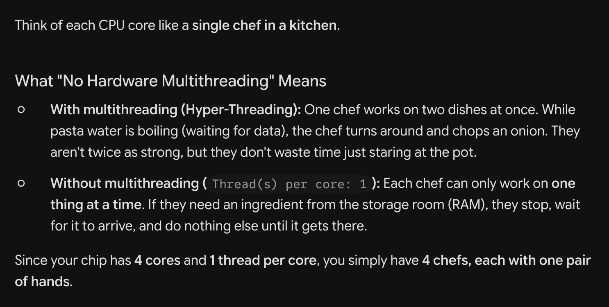
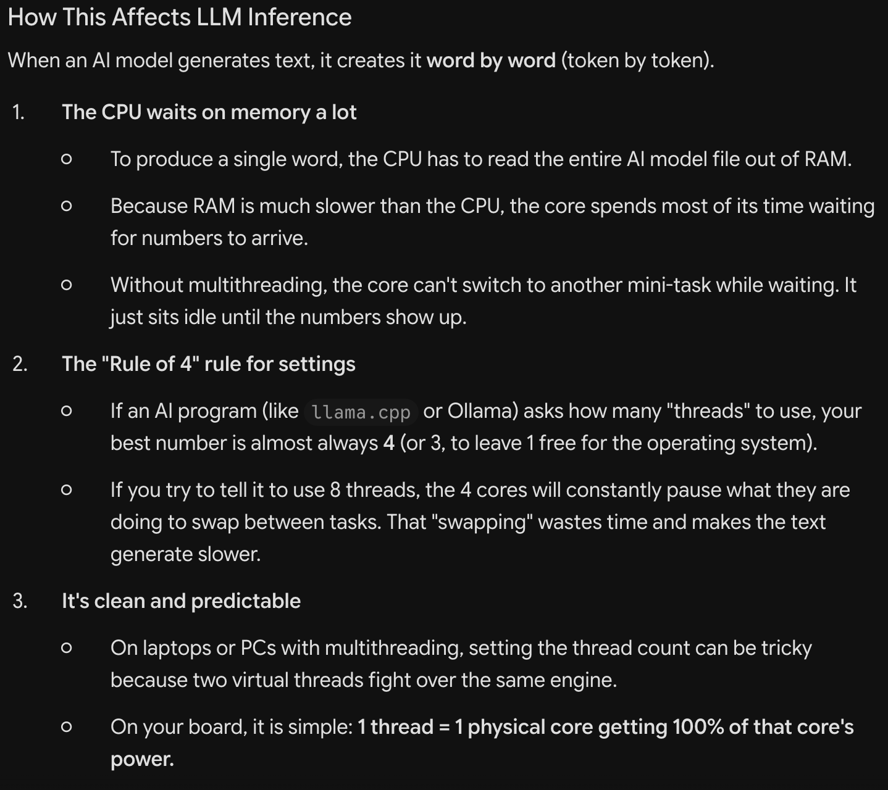
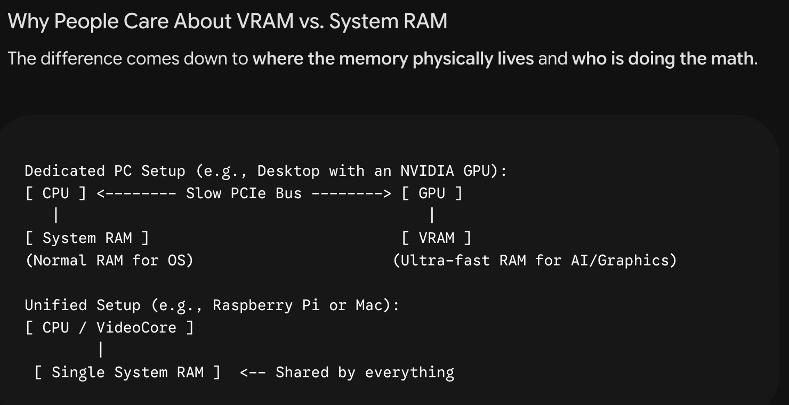

# Raspberry Pi 4 Model B Rev 1.5
- Architecture: aarch64
- CPUS(s): 4 cores
- Thread(s) per core: 1 
=> No hardware multithreading 

# VRAM vs System RAM

## On a PC with a dedicated graphics card:
- The graphics card has its own private, high-speed memory chips soldered right next to the graphics processor called VRAM (Video RAM).

- AI models run significantly faster on a graphics chip than on a CPU. But to use the graphics chip, the entire model must fit inside its VRAM.

- If a model is 12 GB, and your graphics card only has 6 GB of VRAM, the model will not fit on the GPU alone. That is why developers obsess over VRAM on systems running dedicated NVIDIA graphics cards.

## On Raspberry Pi:
- The Pi does not have a dedicated graphics card with separate VRAM chips.

- It uses a Unified Memory Architecture: the 4 CPU cores and the tiny integrated graphics processor (Broadcom VideoCore) share the exact same physical RAM chips.

- Because the Raspberry Pi's small integrated graphics unit does not have the hardware support or compute power to run heavy LLMs, tools like llama.cpp and Ollama run the neural network math directly on the 4 CPU cores.

- Therefore, the model lives directly inside your standard CPU system RAM. On a Pi, your primary bottleneck is whether you have enough available system RAM (seen under available in free -h) to fit the model file without crashing the operating system.

=> If a model size exceeds your available RAM, Linux will either kill the process (Out of Memory / Killed) or push data into Swap, causing the Pi to crawl at virtually zero tokens per second.