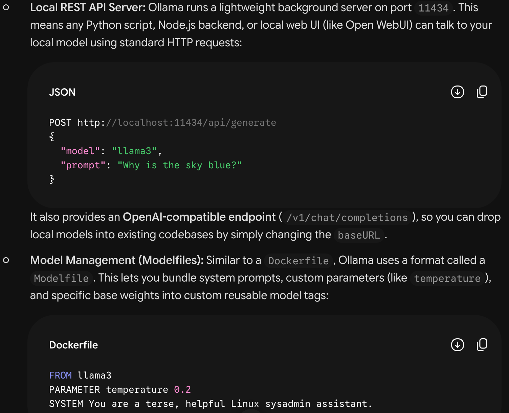

# Ollama
- Ollama is a free, open-source tool that lets you run large language models (like Llama 3, Mistral, or Phi) locally on your own computer with a single command.
=> Think of it like Docker, but for AI models.

- Before tools like Ollama, running an AI model on your own machine was messy:
+ You had to manually download gigabytes of raw model weights.
+ You needed to compile C++ code (llama.cpp), install matching Python environments, and configure GPU drivers.
+ Setting up an API server to connect your apps to the model took dozens of steps.
=> Ollama packages all of that into a clean, background engine. You download the app, type one line in your terminal, and it handles everything else.

## Installation
https://docs.ollama.com/linux

## Ollama API
- The Ollama API is available at 127.0.0.1:11434

## Models
qwen2.5:0.5b: 0.5 billion

## /set verbose
total duration:       31.174024305s
load duration:        11.606457197s
prompt eval count:    244 token(s)
prompt eval duration: 8.551161s
prompt eval rate:     28.53 tokens/s
eval count:           90 token(s)
eval duration:        10.999873s
eval rate:            8.18 tokens/s
| Stage | Time | Meaning |
| Load model | 11.61 s | Prepare the model for inference |
| Evaluate prompt | 8.55 s | Process the input context |
| Generate answer | 11.00 s | Produce 90 output tokens |

=> User’s total wait = time waiting in queue + inference time
